10月18日から20日まで、2泊3日で台南に行ってきました。相方と二人です。

出発前の私は、またしても念入りに計画を立てていました。台南の店は月曜に休むものが多いので、どの日に何が開いているかを一覧表にして、朝の市場から夜の屋台まで分単位で並べたのです。阿里山の日の出を見るか、嘉義に拠点を置くか、屏東の山で原住民料理を食べるか。そんなことを何週間も考えていました。

結論を先に書きます。**遠出は全部やめました。**

そして、やめたあとに残ったもののほうが、ずっと良かった。そういう3日間です。

---

## 1日目：葉家が閉まっていて、相方が倒れた

高雄空港に13:10着。そこからMRTで高雄駅に出て、台鉄で台南へ向かいます。

計画では15:32発の自強号に乗って16:07に着くはずでした。実際に乗れたのは區間快速で、台南に着いたのは **15:55**。ほぼ同じに見えますが、この差が効きました。目当てにしていた **葉家小卷料理が閉まっていた** のです。

代わりに向かったのが **邱家小卷米粉**。

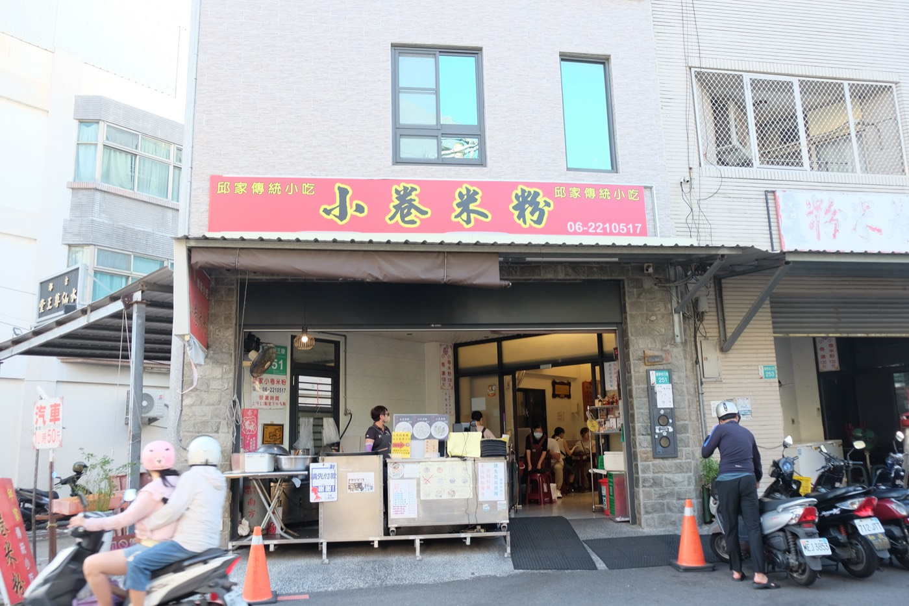

小卷（ヤリイカ）が入った太いビーフンのスープです。美味しかった。ただ正直に書くと、**少し甘すぎたかもしれません。** 台南の料理は全体に甘いと聞いていましたが、本当に甘い。

そして夕方、**相方が体調を崩しました。** 着いて早々です。ここから旅の組み方を、無理をしない方向へ全部切り替えることになりました。

夜は **Walami（瓦拉米）** へ。シダの緑に埋もれた古民家で、鍋燒意麵や松露拌麵を出す店です。私にとっては **新しい台湾の味覚** で満足だったのですが、相方のほうは箸が進まない。体調のこともありますが、伝統料理というより創作寄りなので、**何を食べているのかの文脈が掴みにくかった** のかもしれません。

店にいたゴールデンレトリバーと、そのあとに寄った **莉莉水果店** の果物で、相方は一時的に回復しました。薬より効くものがある。

### 林百貨で茄芷袋を買った

この日のいちばんは、夜の **林百貨** でした。

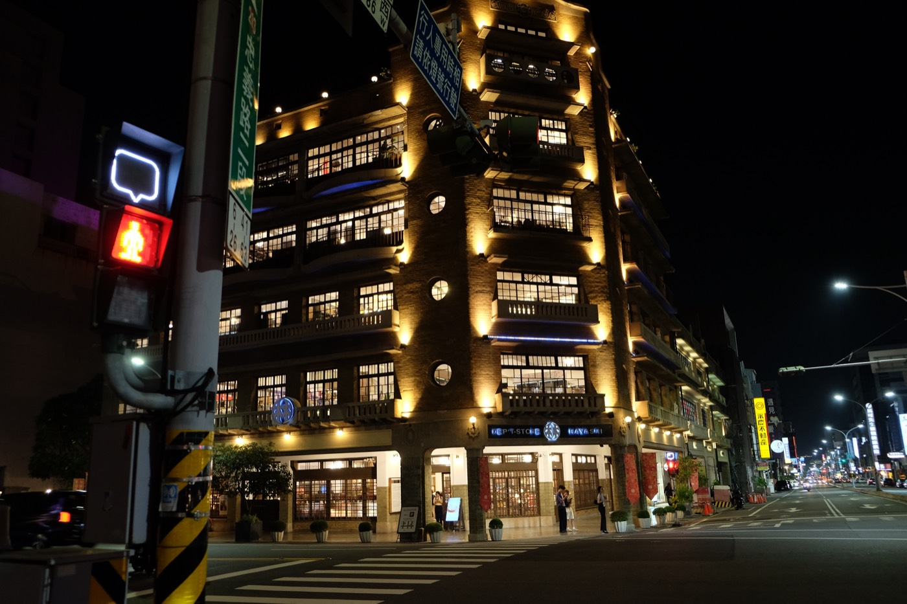

1932年に建った百貨店です。いまは文創の店になっていて、21時まで開いています。ここで **茄芷袋** を見つけました。台湾の市場で昔から使われてきた、赤と青と緑の編み袋です。

台南に来たら必ず寄りたい場所になりました。

もっとも、これは完全に私の趣味です。相方は、**用意された観光地よりも、街で不意に出会うものや歴史の痕跡のほうに心が動く人** だと思います。それでも、レトロな百貨店の愛らしさには感じ入っていた様子でした。

---

## 2日目：朝の公園が、この旅のすべてだった

翌朝、体調はほぼ戻っていました。それでもペースは落としたままにして、Uberを多用し、何度もホテルに戻りながら動くことにしました。

そして朝、**台南公園** へ行きました。

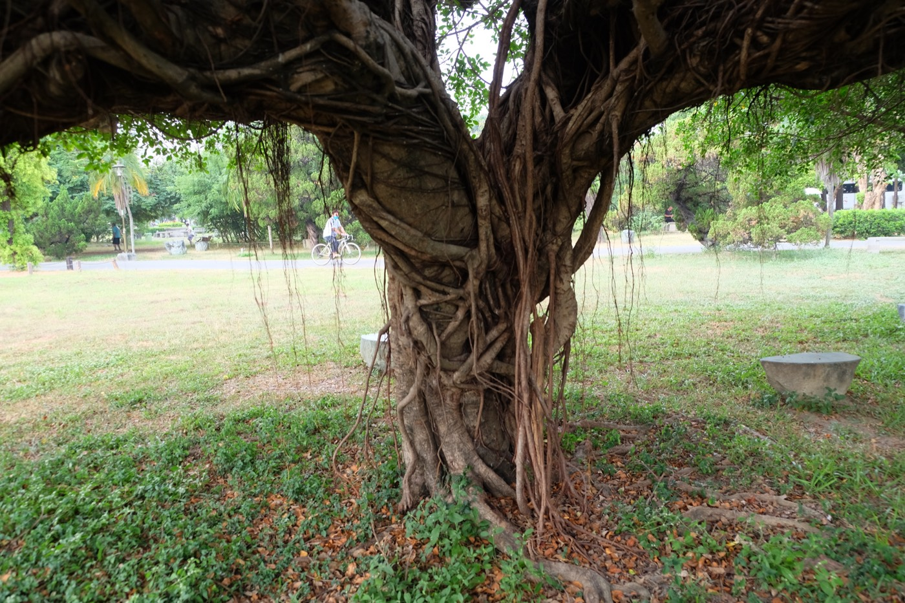

公園のそばの **好運道（天橋下）早餐店** で朝ごはんを買って、木陰で食べます。

これが、**この旅で二番目に良かった時間** でした。とくに **コーン味の蛋餅**。朝の空気と一緒に食べると、やたらと旨い。

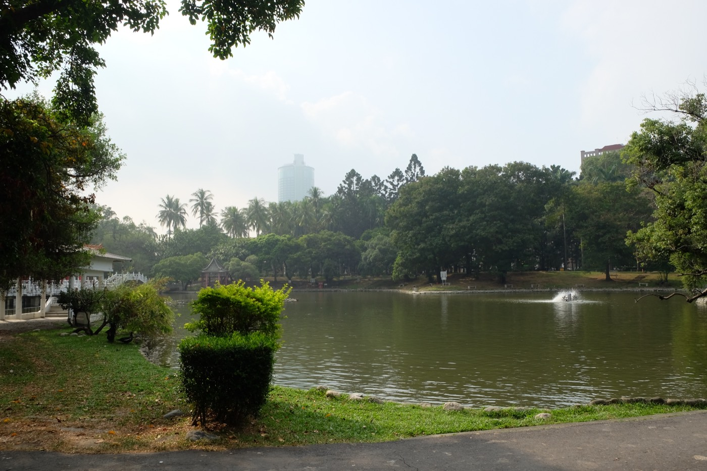

公園には **台湾リス** がいて、**太極拳をしているおばさん** がいました。それを眺めながら座っていた30分くらいが、3日間でいちばん旅らしい時間だったと思います。

旅程を詰めていたときの私は、ここに何の価値も見出していませんでした。「朝は虱目魚（サバヒー）の粥を食べて、すぐ安平へ」と書いていたくらいです。**やはり自然の成分が必要だったのだと思います。**

### 文章牛肉湯は、素朴だった

昼は安平へ移動して **文章牛肉湯**。台南の牛肉湯は月曜に休む店が多いなか、ここは木曜休みなので開いています。

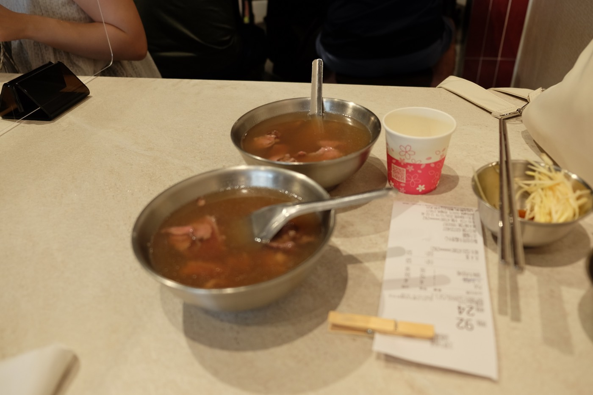

大人気の店で、**注文のしかたも、薬味を自分で作る仕組みも面白かった** です。ただ味のほうは、日本人の舌からすると「ものすごく美味い」というより **素朴** な感じでした。

むしろサイドで頼んだ **牛肉炒飯** の味付けがよかった。こういうことがあるから外食は面白い。

### 安平で、歴史に触れた

午後は **安平古堡** から。

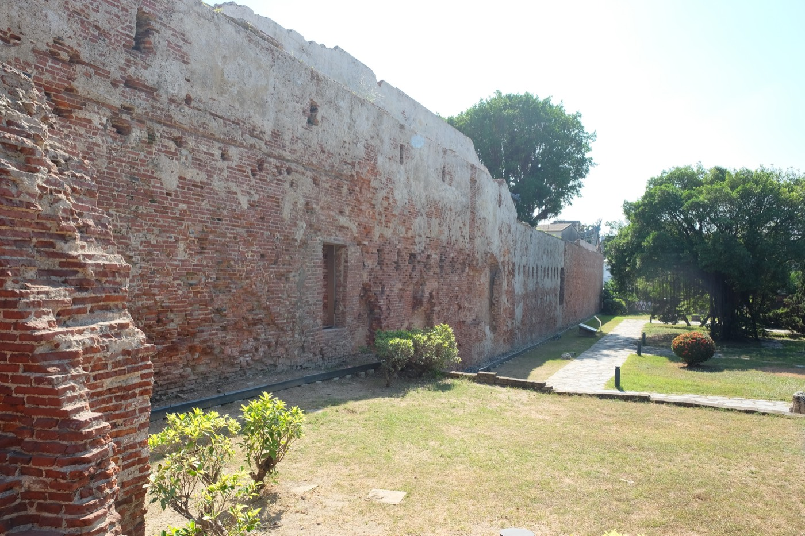

17世紀にオランダ人が建てたゼーランディア城の跡です。白い塔は1975年の展望台なので、**本物はこのレンガの壁の断片** だけ。それでも、400年前のオランダがここにあったという事実は動きません。

相方がいちばん感動していたのは、この古堡でした。彼女は原住民を含む **台湾の歴史の深い部分** に関心があって、その一端に触れられたことを喜んでいました。

続いて **安平樹屋**。

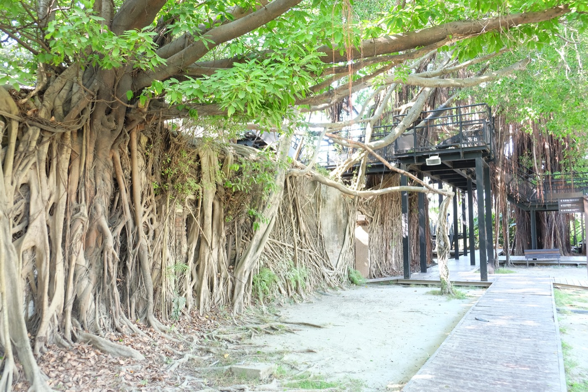

19世紀のイギリス商館 **德記洋行** の倉庫を、ガジュマルの気根が丸ごと飲み込んでいます。屋根も壁も根に覆われていて、建物と木の境目がもう分からない。

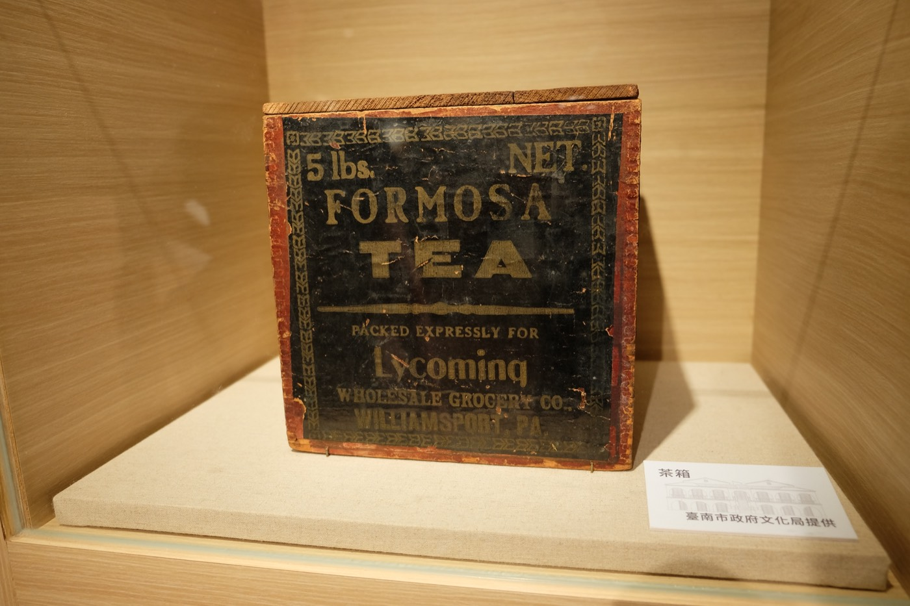

同じ園内の展示に、**FORMOSA TEA** と書かれた古い茶箱がありました。ここはお茶を扱う商館だったわけです。台湾の茶が船で世界に出ていった時代の、現物。

**この旅で三番目に良かったのは、安平で歴史を知ったこと** でした。

### 屏東には、行かなかった

この日の夕方は、本当は **屏東** へ行くつもりでした。台鉄で1時間、勝利星村という日本統治期の宿舎群を歩いて、汕頭火鍋で温体牛を食べて、夜市を回って帰る。そういう計画です。

**行きませんでした。** 遠すぎて、時間が惜しかった。

代わりに近場の **大東夜市** へ行ったのですが、こちらは正直あまり感動がありませんでした。台北の夜市の揚げいも団子あたりと比べてしまったのです。**同じ感動を求めようとしたのが失敗の元** だったと思います。台南には台南の時間がある。

---

## 3日目：泥棒のアジトみたいな市場で、麺を食べた

最終日の朝。**鴨母寮市場** へ行きました。

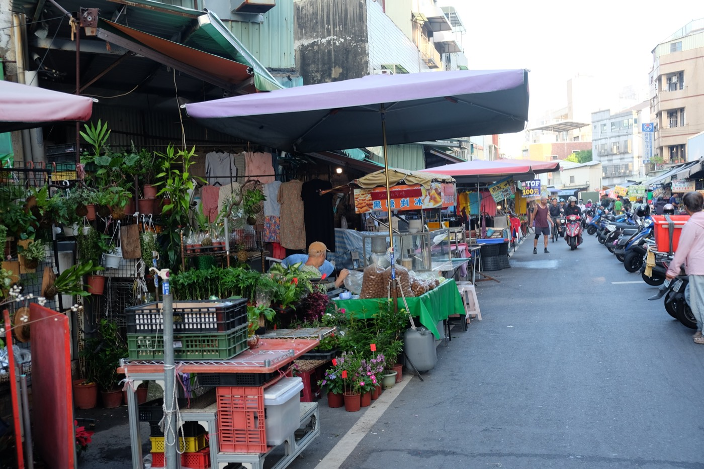

目当ては **垃圾麵（ゴミ麺）**。60年続く炭火の麺屋ですが、市場の奥にあって **看板がありません**。人に聞きながら、薄暗い通路を進んでいきます。

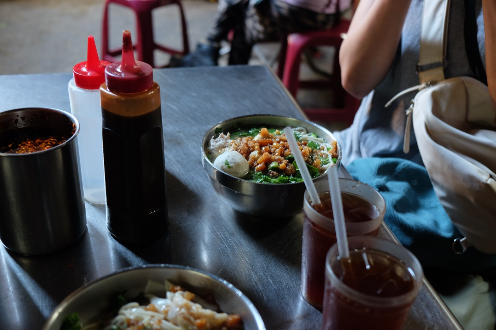

**乾麵と湯麵をひとつずつ** 頼みました。相方は湯麵を美味しそうに食べていて、私は初めて食べた乾麵のほうが好きだったかもしれません。

あとから振り返って、二人で言っていたのは **「泥棒のアジトみたいだったね」** ということです。褒め言葉です。3日目の締めの冒険として、これ以上ないものでした。

そのあとは台鉄で高雄へ出て、駅の周りを少し歩き、50嵐で無難なお茶を飲んで、空港へ。

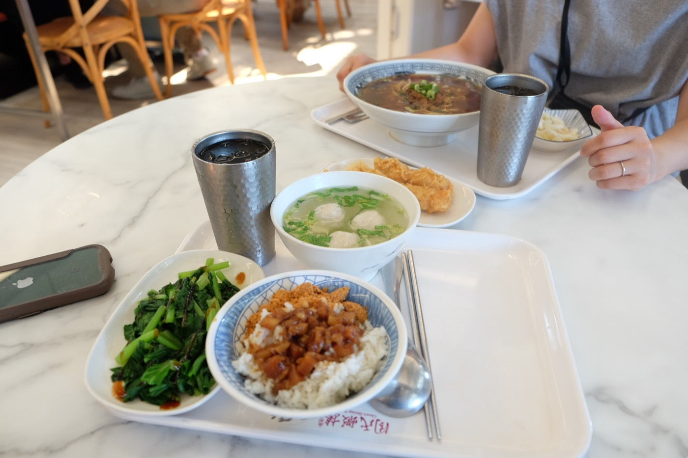

---

## 捨てた計画と、残ったもの

出発前に私が組んでいた予定と、実際にやったことを並べます。

| 計画 | 実際 |
|---|---|
| 15:32の自強号／葉家小卷料理 | 區間快速で15:55着、邱家へ |
| 神農街を歩く | 合わなかった |
| 2日目朝：虱目魚の粥 | 台南公園で朝ごはん |
| 安平（古堡・樹屋・牛肉湯） | 予定どおり |
| 2日目夕方：屏東まで遠征 | 行かず |
| 3日目朝：垃圾麵 | 食べた |
| 3日目：高雄の原住民故事館 | 評判を調べて見送り |

こうして並べると、**捨てたのは全部「遠出」** でした。屏東も、検討段階で落とした阿里山も嘉義も、行かなくて正解だったと思います。

そのかわりに増えたのが、公園で座っている時間と、市場をうろうろする時間でした。**旅の密度は、移動距離とは関係ない。** 当たり前のことですが、計画表を作っているときの自分はそれを完全に忘れています。

天気には恵まれました。3日間ずっと晴れ。ただ10月といっても湿度も気温もまだ高いので、次はもう少し涼しい時期を狙いたいところです。

次に行くなら、朝の時間に重心を置いて組みます。それから、今回は一端にしか触れられなかった原住民の文化を、屏東の三地門や霧台まで足を伸ばして見てみたい。それだけで独立した旅になるはずです。

帰ってきた日、相方がぽつりと言いました。

> 不思議だな、台湾、また行きたいな

計画を半分捨てた旅の感想としては、上出来だと思います。
