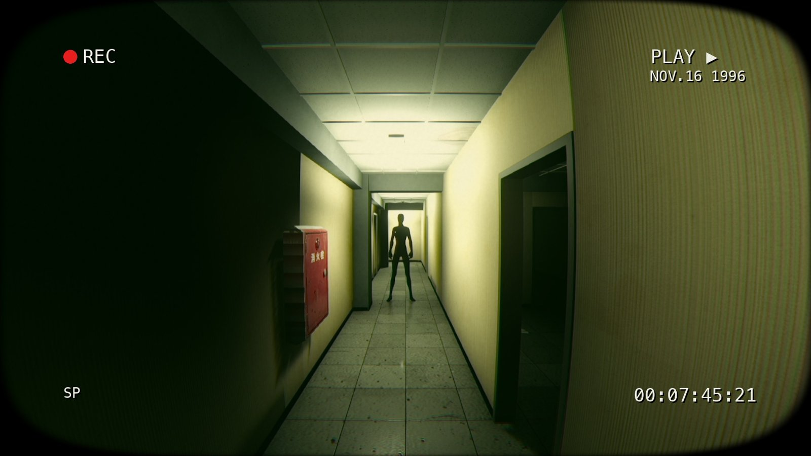
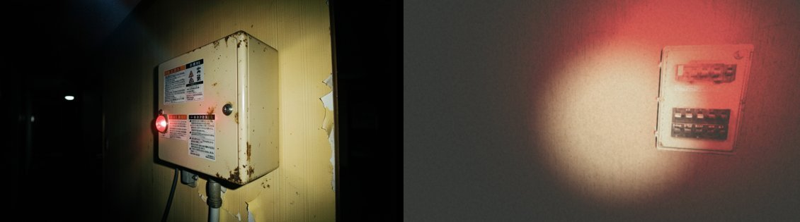
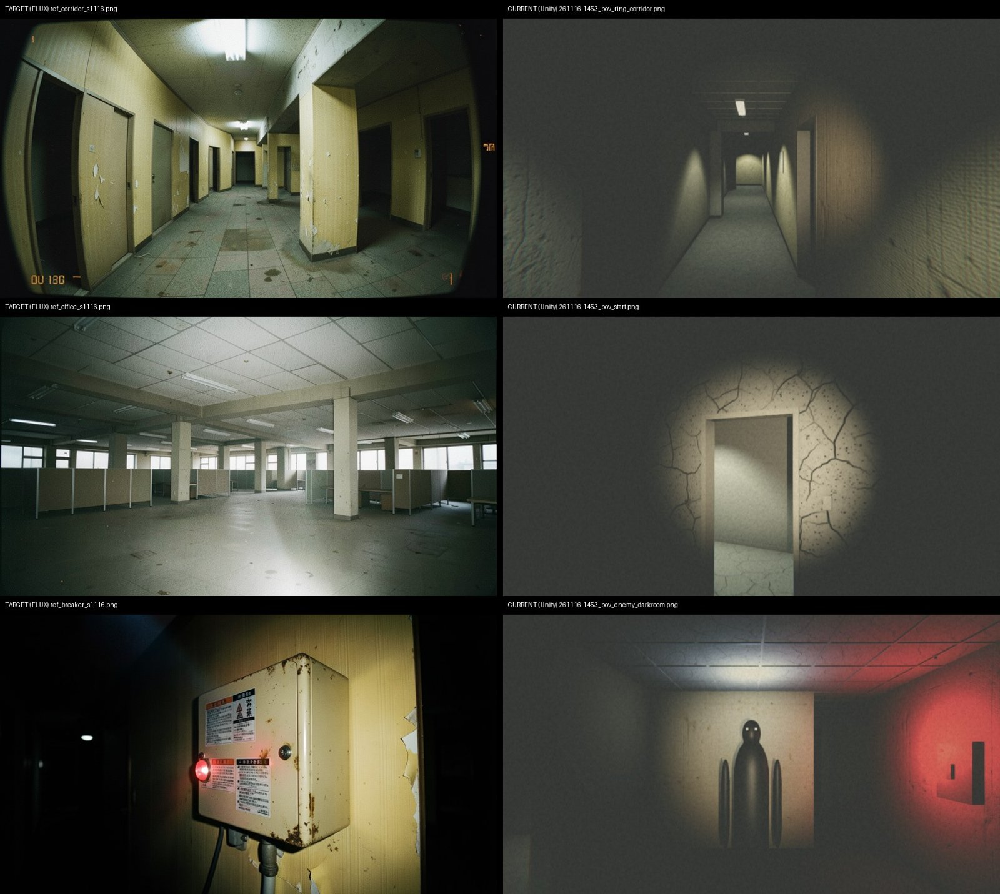
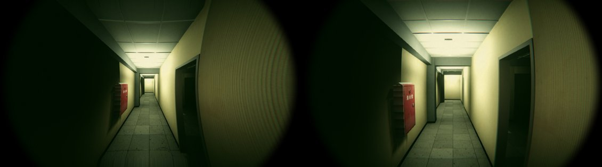
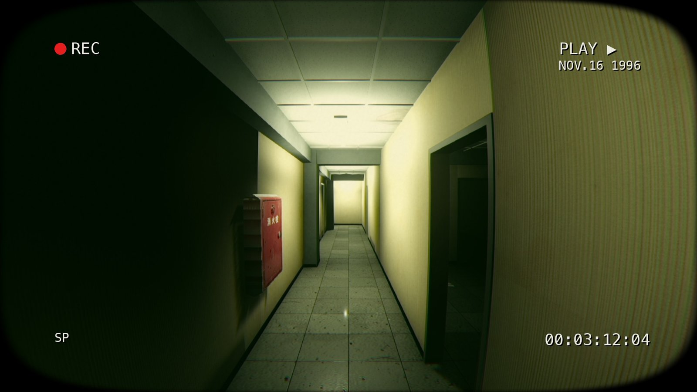
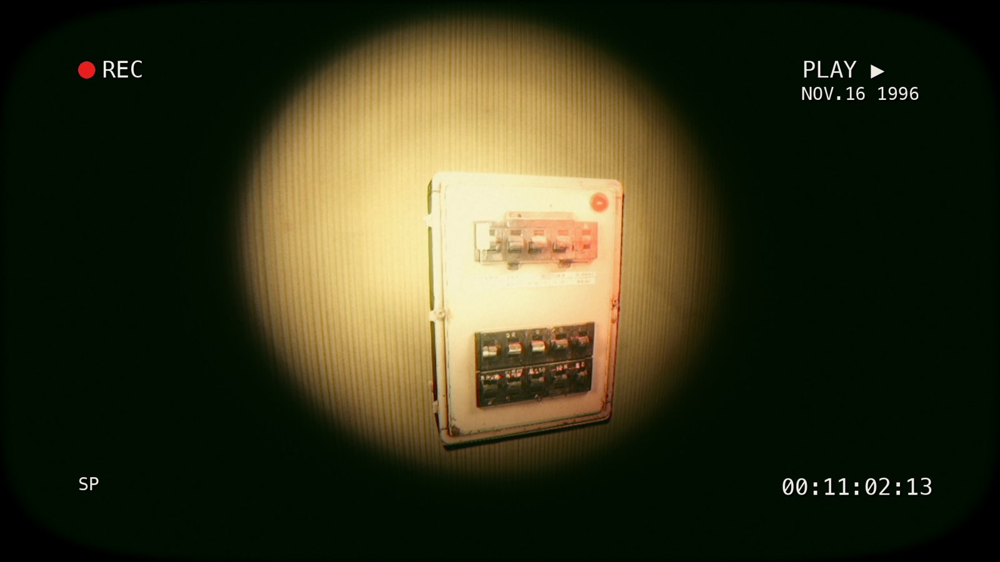
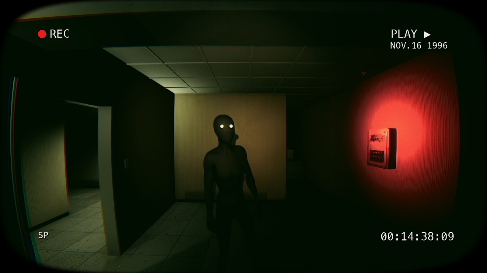
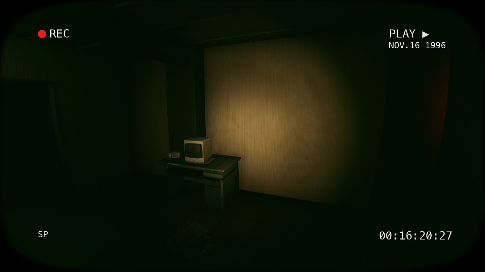
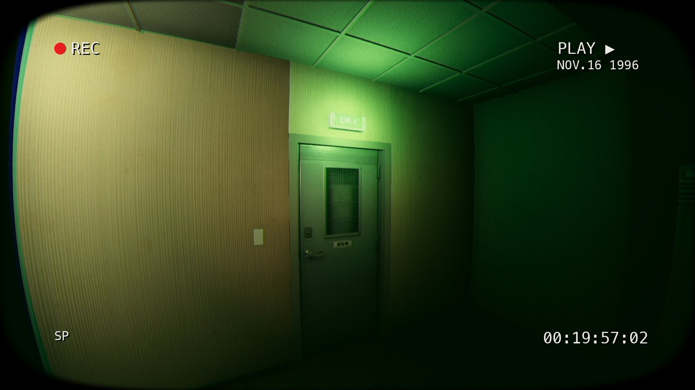

11月16日、1日でホラーゲームを1本作りました。タイトルは **『LiminalTape』**。1996年、閉鎖された雑居ビルの3階を、手持ちのビデオカメラのライトだけで歩き回り、ブレーカーを3つ入れて非常階段から逃げる、一人称のファウンドフッテージ・ホラーです。

作ったのは私ひとりではありません。**AIのチーム**です。私はディレクターとして方向を決め、手を動かしたのはほとんどAIでした。

結論を先に書きます。**完成はしました。でも、出来には満足していません。** そして一番の反省は、**既存のアセットを使わなかったこと**です。

---

## チームの組み方

役割は次のように割り振りました。

| メンバー | 役割 |
|---|---|
| Claude Opus | 指揮役。設計、実装、統合、検証 |
| Claude Fable | 顧問。節目ごとのレビュー |
| Claude Sonnet | 実装の補助（UIまわり） |
| Gemini（Argon） | 相談役。ゲームデザインへの反論と、計画の組み直し |
| Gemini（Hydrogen） | 画像の診断と採点、長いコードの生成 |
| Gemini（Flash） | 画像生成用のプロンプト作り |
| FLUX.2 klein / Hunyuan3D v2 | 画像と3Dモデルの生成（どちらも自宅のPCで、無料） |

「Geminiは画像の理解に強い」という仮説を持っていたので、Geminiには美術とゲームロジックの相談役と、トークン節約のための作業の肩代わりを任せました。途中でClaudeの使用枠が残り少なくなったときは、Antigravity（Gemini）に作業を丸ごと引き継いでもらい、引き継ぎ書を書かせて、またClaudeに戻しています。

## 作り方：アニメーション以外は、すべて生成

アセットストアの素材は使っていません。

- **建物**：寸法を1つのJSONにまとめ、FreeCADで平面図を作ってDXFで書き出しました。それをBlenderで立ち上げています。Blenderのスクリプト（2174行）は、Gemini Hydrogenが書いたものが修正なしで動きました。
- **小道具**：FLUXで「製品写真」のような画像を作り、Hunyuan3Dで立体にしました。Blenderで実寸に合わせ、同じ画像を正面から投影して色を付けています。分電盤、消火栓、扉、ロッカー、ブラウン管モニターなど、全部で15種類です。
- **汚し**：FLUXで「白い紙の上の染み」を作り、白い部分を透明にして貼りました。最後は、コードで作った汚れに一部を置き換えています。
- **敵**：FLUXでTポーズの画像を作り、Hunyuan3Dで3Dにしました。リグとアニメーションはMixamoです（ここだけ既存の素材を使っています）。動きは秒間12コマのカクつきにしてあります。これは、私が作っているリミテッドアニメの練習も兼ねています。
- **音**：素材ファイルはひとつもありません。足音、息づかい、蛍光灯のハム音、見つかった瞬間の「ギュイッ」という音まで、すべてコードで合成しています。

## 手直しの連続

1日の大半は、作ることより**直すこと**に使いました。印象に残っているものを挙げます。

**「何が起きているのか分からない」**　最初のビルドを遊んだ私の感想です。画面全体にノイズがかかり、真っ暗で、敵が見えないまま背後から捕まって終わる。危険を知らせる合図と、視界をふさぐものが同じだったのです。Geminiに相談して、「廊下は明るく、部屋は暗く」という明暗の設計に切り替えました。

**「そもそもモデルが全然違うくない？」**　照明や色をいくら詰めても、参考画像に近づきませんでした。原因は、画面に映る物そのものが箱と円柱だったことです。AIの採点は、形の重みを低く見積もっていました。ここは私が気づいて、小道具を画像から3Dにする方法に切り替えています。

**魚眼が逆向き**　「壁が膨らむ魚眼にしたい」と頼んだら、中心に引っ張られる逆の歪みになっていました。Claudeがシェーダーのコードを読んで、値の符号が逆だったことを突き止めています。

**ブレーカーが壁に埋まっていた**　コンパイルもビルドも通るのに、クリアできない状態でした。Fableが座標を計算して、3つのうち2つが外壁の中に埋まっていることを見つけています。

## 完成したもの

最終的なビルドは、Mac版とWindows版の2つです。手元のIntel Macでは、平均55fpsほどで動いています。

## Geminiは壁打ち相手として優秀だった

仮説のとおり、Geminiは壁打ち相手として優秀で、特に美術面の助言が的確でした。スクリーンショットと参考画像を並べて見せると、「参考画像は廊下が明るく、部屋が暗い。いまの画面は明るさの分布が逆だ」と、具体的に指摘してくれます。

ただし、外れもありました。ライトのベイク（光の事前計算）を勧められましたが、これは蛍光灯の明滅と矛盾します。ここはArgonが指摘して取りやめました。逆向きの魚眼を入れたのもGemini側です。それをClaudeが気づいて直しています。**AI同士で互いの間違いを拾い合える**のは、チームにした大きな利点でした。

Fableも顧問として良い仕事をしました。ただ費用対効果で言えば、別の使用枠で動くGemini（HydrogenやArgon）のほうが上だと感じています。

## 反省：アセットを使えばよかった

アニメーション以外のアセットは、すべてゼロから生成しました。正直に言えば、これは私の悪いこだわりです。

画像から3Dを作る仕組みそのものは、面白いし練習にもなりました。ただ、小道具1つを作るたびに、向きを直し、ポリゴンを減らし、文字が崩れれば手で描き直し、という手間がかかります。既存のアセットを使っていれば、その時間を遊びの調整や見た目の詰めに回せたはずです。

出来にも満足していません。参考画像と比べると、まだ「CGの貼り絵」に見える部分があります。手直しはまだまだ必要です。

それでも、**AIのチームで、1日でここまで作れる**ことは分かりました。次はアセットも素直に使い、そのぶんAIには、判断と仕上げのほうで力を借りるつもりです。
