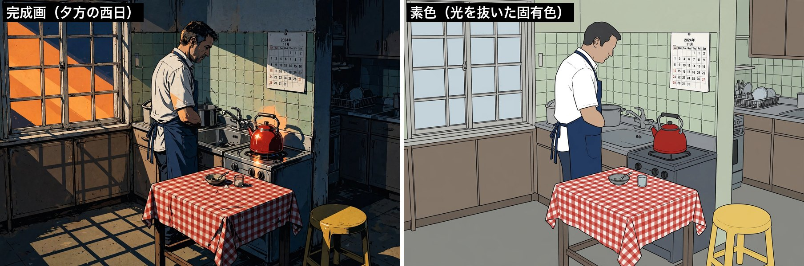
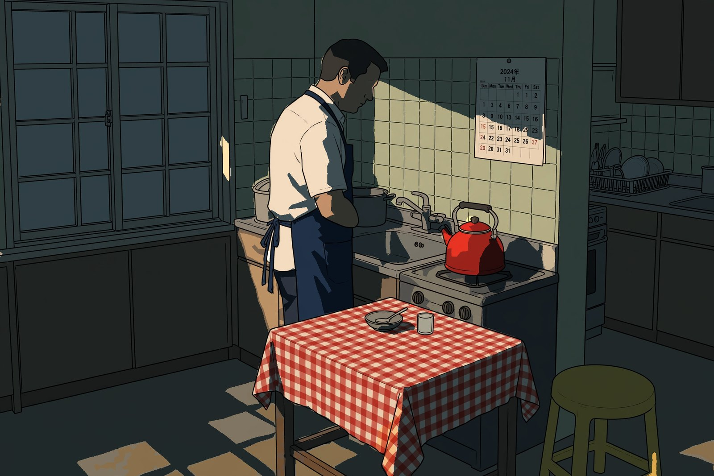
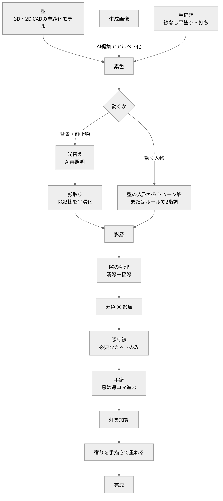
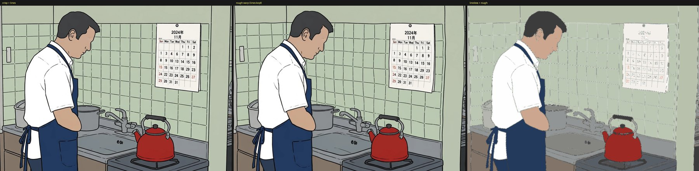
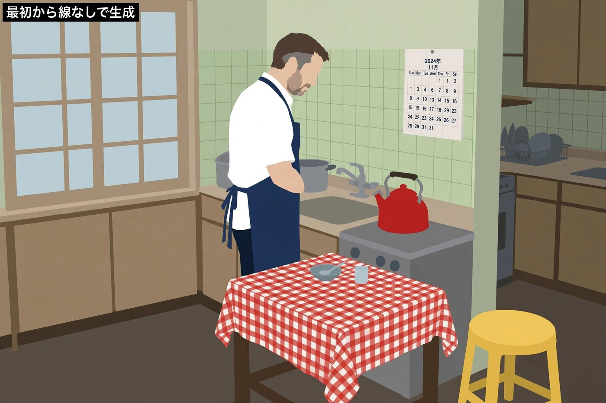
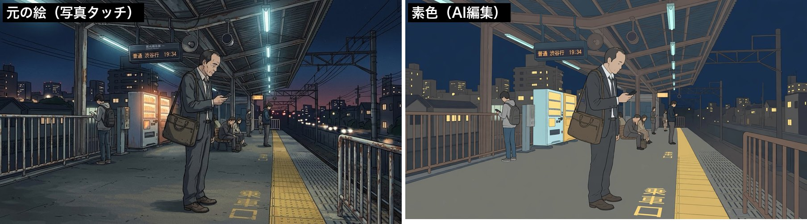
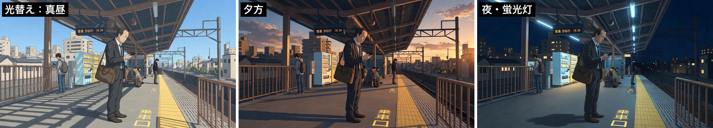
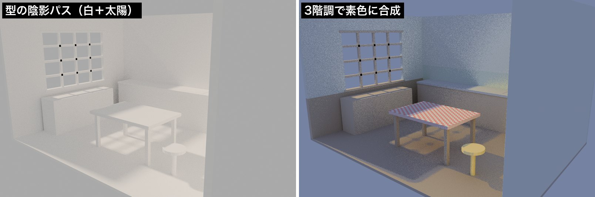
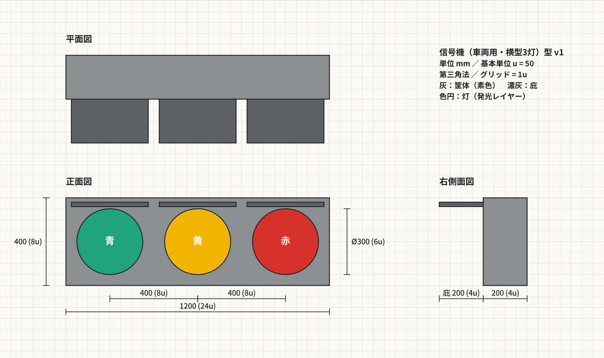

リミテッドアニメを作るための、自分なりの様式をまとめました。名前は **遅光(ちこう、Late Light)** です。

一言でいうと、**世界を光なしで描き、光と影を後から置く**作り方です。手描きは「線なしの平塗り」だけを担当し、陰影・輪郭・揺れは別の層として後から重ねます。

きっかけは、漫画家の[山田胡瓜さん](https://x.com/kyuukanba)が、AIにトーンを貼らせたり削らせたりしているという投稿でした。画像生成ではなく、AIが作業できる環境を作り、仕上げを任せる。その発想をアニメの陰影に持ち込めないか、とClaudeと議論し、実験しながら組み立てたのがこの体系です。

---

## 1. 遅光とは

### リアリティ論

アニメのリアリティは、フォトリアルに近づくことでは生まれない、と考えています。リアルを感じさせるには、むしろ現実のリアルから離れる必要があります。

- **見た目のリアル**：光や質感の光学的な正確さ。フォトリアルが目指す層。
- **動きのリアル**：重さ、間、芝居が本当らしいこと。
- **体験のリアル**：見た人が「この感じを知っている」と自分の記憶に結びつけること。

遅光が狙うのは後ろの二つです。人の記憶はすでに抽象化されていて、夕方の台所は「西日のオレンジの面」と「影の青さ」くらいの色と形で残っています。略した絵ほど、見る人が想像で補い、描かれていないものまで感じ取ります。

### 三原則

1. **素色先行**：まず光のない世界を描く。
2. **光後置**：光と影は後から置く。描き直さず、差し替える。
3. **縁は光に従う**：輪郭は断定せず、光が許した場所にだけ現れる。

個々の要素(3DCGのパス分け、色トレス、絵画のロスト・アンド・ファウンド・エッジ)には先例があります。新しいのは、それらを手描きのリミテッドアニメとAI再照明で一つの体系にまとめた点です。

---

## 2. 理論：分解とレイヤー

完成画は、固有色と陰影の積に、自ら光るものを足したものとして扱います。

```
完成画 ≒ 素色 × 影層 ＋ 灯
```

この分解によって、手描きの仕事は「線なしの平塗り」だけになります。最も重い「影の形をコマごとに整合させる」作業は後工程に分離され、光源が昼から夜に変わっても描き直しは要りません。



左が完成画、右がそこから光を抜いた素色です。窓の格子の影も、やかんの照り返しも消えて、色の面だけが残ります。この右側だけを描けばよい、というのが遅光の出発点です。

### 用語集

名前をつけておくと、AIへの指示もぶれなくなります。

| 遅光の用語 | 中身 | 扱い |
| --- | --- | --- |
| 素色(そしょく) | アルベド。線なし・平塗りの固有色 | 手描きの本体。色指定表で固定 |
| 影層(えいそう) | 陰影の乗算レイヤー。RGB比で光の色も持つ | 光源条件ごとに差し替え |
| 際(きわ) | 影の境界の帯 | 画風の看板。清際・揺際で処理 |
| 灯(ともし) | 発光レイヤー(信号、窓明かり、自販機) | 素色と必ず分離し、最後に加算 |
| 紋(もん) | 柄・文字 | 線なし化・線抽出の処理から保護 |
| 照応線(しょうおうせん) | 影の深さで濃さ・太さ・色が変わる輪郭線 | 必要なカットだけ後付け |
| 光替え(ひかりがえ) | AI再照明 | 背景・静止物専用 |
| 影取り | 光替えの画像から影層を抽出する工程 | 比を平滑化して取る |
| 手癖(てぐせ) | 保存済みの歪み場セット | シード固定、全レイヤー共通 |
| 打ち／息 | ポーズの時間／揺れの時間 | 「打ちは4、息は毎コマ」 |
| 型(かた) | ガイド用の単純化した3D・2Dモデル | 画面には出さない |
| 宿り(やどり) | 瞳のハイライト | 位置は計算、形は手描き |

### 影層の取り方

影層は、光替えした画像と素色の比から取ります。輝度だけで比を取ると光の色が落ちました(台所の実験で相関0.68)。階調ごとにRGB比の中央値を持たせると、西日の暖色と影の青みが両方戻ります。セル調にするなら、比を3階調にポスタリゼーションして影色を掛けます。



台所の素色に、RGB比で取った影層を3階調のセル影にして掛けたものです。日なたの暖かさと影の青みが、両方残っています。

---

## 3. ワークフロー

素色を作り、背景と人物で別々の方法で影層を付け、最後に揺れと光を重ねます。背景と人物の分岐が、このワークフローの要です。



1. **素色を作る**：型からレンダーパスで直接出すか、生成画像をAI編集でアルベド化する。手描きの部分は、最初から線なしの平塗りで描く。線は後から消すより、作る時点で省くほうがきれいに仕上がる。
2. **影層を付ける**：背景は光替えから影取りする。動く人物は、型の人形から影を取るか、光の向きに沿ったルールで2階調を付ける。
3. **際を整える**：影の境界を多角形に単純化して硬いエッジにし(清際)、低周波ノイズで弱く揺らす(揺際)。
4. **合成する**：素色に影層を乗算する。線が必要なカットだけ、照応線を重ねる。
5. **揺らす**：保存済みの手癖を全レイヤー共通にかける。
6. **光を足す**：灯を加算し、瞳には手描きの宿りを置く。

「線は作る時点で省く」は、試して分かったことです。



左から、線ありの元の絵、線を残したまま手癖で揺らした絵、後から線を消して揺らした絵です。後から線を消すと、カレンダーの数字のような細かい情報まで一緒に崩れます。



こちらは、最初から「輪郭線なし、柄と文字は色の模様として残す」と指定して作った素色です。線だけが落ちて、テーブルクロスのチェックもカレンダーの数字も残りました。手で描くなら、最初から線なしで描くのと同じことです。

---

## 4. 背景と人物の分担

AI再照明は幾何が固定された背景・静止物専用とし、動く人物の影はルールか型で付ける。2026年11月の実験で、この分担が数字で裏付けられました。

### アルベド化の実験

| 素材 | 画風 | 生成AIでのアルベド化 | 光替え |
| --- | --- | --- | --- |
| 台所 | 平塗りのグラフィックノベル調 | 構図のずれ小、色もほぼ正確 | 朝の曇り・夜の蛍光灯、成功 |
| 駅ホーム | 写真タッチ | 意味的には成功、構図のずれと色の解釈違いあり | 昼・夕・夜、成功(輝度相関0.948) |

ピクセル処理(Retinex＋減色)では、影側の素材を固有色まで持ち上げる判断ができず、暗さが帯状に残りました。画風が平塗り寄りなほど変換精度が上がることも分かりました。



駅ホームでは、AI編集で素色を作りました(右)。素材ごとの意味が分かっているので、影の中のスーツも点字ブロックも、同じ固有色にそろいます。



その素色から、光の条件の文章だけを差し替えて、真昼・夕方・夜を作りました。構図と色はほぼ保たれています。ただ、行先標の「19:34」は素色に焼き込まれていたので、真昼でも光ったままです。灯を素色と分ける必要がある、と分かったのはこの一枚からでした。

### 動く人物の影の比較

線なし素色で腕を上げる3ポーズを作り、夕方の西日で比べました。

| 方式 | 結果 | 背景のちらつき(標準偏差) | 人物の平均陰影 |
| --- | --- | --- | --- |
| コマごとにAI再照明 | 不成立。人物の比率が描き直され、位置合わせ3種すべて失敗 | 0.105 | 0.80 → 1.13 → 1.24 |
| 両端だけ再照明して補間 | 不成立。両端の位置合わせ自体ができない | 0.076 | — |
| ルールで2階調(右40%を影＋固定の落影) | 成立。腕の動きに影が正確に追従 | 0.0001 | 0.814 / 0.808 / 0.814 |

その後、歩行サイクル4コマを線なし素色で作り、塗りつぶしだけで歩行が成立しました。

<video src="/my-astro-blog/chikou/walk4_v3.mp4" autoplay loop muted playsinline style="width:100%;height:auto;"></video>

各組の左が素色だけ、右がルールの2階調の影と足元の落影を足したものです。描いたのは4ポーズの塗りだけで、影は機械が付けています。

ただ、ルールの「右40%」は腕の上げ下げなら十分でも、体のねじれや腕が胴に落とす影には限界があります。そこは型の人形から影を取ります(6章)。

---

## 5. 揺れと線

### 打ちと息

ポーズの時間(打ち)と揺れの時間(息)を分けると、描く枚数を増やさずに画面が生き続けます。各ポーズを4コマ保持しても、歪み場は毎コマ進め、保存した8枚を循環させます。保持中の絵が凍りません。

<video src="/my-astro-blog/chikou/boil_loop.mp4" autoplay loop muted playsinline style="width:100%;height:auto;"></video>

1枚の絵に、保存した歪み場だけをかけて回したものです。絵は描き足していませんが、止まって見えません。

画面全体が常に揺れていると、目は細かいずれを誤差として読まなくなります。フィルムグレインが色の段差を隠すのと同じ原理で、**手癖の振幅より小さい描き手のずれは吸収されます**。手描きの精度を問わない代わりに、絵の生気を得る交換条件です。基本スタイルの振幅は10px(1920px幅)にしました。

手癖の運用規則：

- 歪み場は低周波のみ(波長 約256/96/48px)。高周波は輪郭を震わせる。
- 場はシード固定で生成・保存し、全レイヤーに共通でかける。レイヤーずれが原理的に起きない。
- コマごとにランダムな場を作らない(ちらつきの原因)。
- 顔と紋は振幅を半分にする。場は共通、強さだけ変える。
- サイクルでない長い芝居では、場の枚数を打ちと割り切れない数(7枚など)にして、繰り返しを目立たせない。

### 照応線

輪郭線は概念で、陰影は現象です。現実の境界は光で現れたり消えたりするのに、輪郭線は光に関係なく「ここで終わる」と言い切ります。この断定が、光学的な陰影と衝突します。

照応線は、線を光の結果として出します。陰影レイヤーの値で、線の三つの性質を決めます。

- **濃さ**：日なたで消え、影が深いほど濃くなる。
- **太さ**：深い影の中だけ少し太くする。
- **色**：黒ではなく、その場の固有色を暗くした色にする(色トレス)。

---

## 6. 型と単純化、瞳と宿り

型は「正確」より「影がきれいに落ちる形」であるべきで、意図的に単純化します。構造の正しさは型が、おおらかさは手描きと手癖が担います。型は最終的に画面から消えます。

### 型の作り方

- **人物**：AI生成より、関節の動くデッサン人形が早い。Blenderのリグに円柱と球を付ける程度で十分。トゥーンで2階調の影マスクだけ書き出す。
- **室内・建物**：2D CADで間取りと配置を描き、DXFをBlenderで押し出す。2Dは座標と単純図形だけで書けるので、AIが最も得意な領域。



台所の型を、すべて50mm単位の箱と円柱だけでBlenderに建てました。全部を白い素材にして太陽を置くと(左)、窓の格子の光と家具の落影が、清書に近い形で出ます。それを3階調にして素色に掛けたのが右です。2Dだけでは光の向きから影の形を計算できませんが、型があれば、太陽を置くだけで影が設計データになります。サンプル数が少ないと粒状のノイズが残るのは、今後の課題です。
- **小物**：寸法を基本単位(u=50mm)の整数倍に丸め、曲面は平面に置き換える。
- AI生成のローポリ(Meshy、Tripoなど)は軽くはなるが、細部の凹凸が残り、影が汚れる。気になる面は手で平らにする。

試しに、信号機の型をAIに2D CADで描かせました。筐体は24u×8u×4u、灯はØ6u、半円筒のフードは平らな庇に置き換えています。灯の上に落ちる影がまっすぐな帯になり、際の処理が楽になります。



### 距離による単純化

| | 近景 | 中景 | 遠景 |
| --- | --- | --- | --- |
| 型 | 図面の精度 | 箱と円 | 箱ひとつ |
| 素色 | 柄・紋も残す | 主要な色面 | 1〜2色のシルエット |
| 影層 | 2〜3階調＋落影 | 2階調 | 影なし、明度を少し下げる |
| 照応線 | 影側に出す | ごく薄く | 出さない |
| 灯 | 形ごと | 色の点 | 夜だけ光の点 |
| 手癖 | 通常の振幅 | 弱める | ほぼ止める |

遠景は「形」より「光の配置」で語ります。

### 瞳と宿り

瞳は顔の表面に貼られた丸として、顔の向きに応じて計算で潰します。カメラから見た角度をθとすると、横幅は (cos θ)^k 倍。k > 1 で潰れを誇張し、k < 1 で記号的に丸を保ちます。3/4の角度では、近い目を大きく、遠い目を小さく誇張すると奥行きが出ます。

ハイライト(宿り)だけは完全に手描きにします。光の映り込みは光源とカメラで決まり、瞳の上を滑り、形もほとんど潰れません。位置は型と光源から計算し、形は手で描いた2〜3パターンを打ちとは別の周期で循環させます。構造は機械に任せ、命の部分だけ手で描く。遅光の考え方が、目という一番小さな場所に凝縮されています。

### 次の実験

- 実際に手描きした数コマの素色を、動画として回す
- 型の人形から人物の影を取り、ルールの2階調と比べる
- 照応線の三つの版(影側だけ／色トレス一定／日なた側に明るい線)を比べる
- 紋を保護するマスク運用を実装する
- 色指定表を変換プロンプトに埋め込み、線なし生成の色ずれを抑える
- 瞳の潰れ k と、近い目・遠い目の誇張率を試すツールを作る
